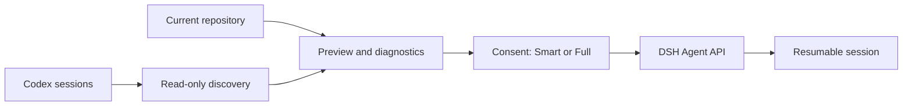

# DSH Codex Handoff

English | [简体中文](README.zh-CN.md)

Continue a Codex coding task in **DeepSeek Harness (DSH)** with a preview of the conversation and the repository as it exists now.

**Status: developer preview · MIT · Web profile only.** Compatibility is pinned to DSH commit `d347e703908d0406b7a7ef80e3a0e594d86b2215` (`0.1.3-alpha.1`). This is an independent community plugin; newer DSH versions require validation.

## What it does

- Discovers active and archived Codex sessions without changing their source files.
- Shows repository, file, size, and history diagnostics before importing.
- Offers **Smart** handoff: deterministic repository facts, optionally summarized by the current DSH model, with a degraded fallback when that model is unavailable.
- Offers **Full** handoff: safely representable messages and closed tool-call pairs, without replaying historical commands.
- Creates a normal, resumable DSH session through the typed Agent API. Fingerprints make equivalent retries idempotent.



## Build and install

Requirements: Git, Node `^22.19.0 || >=24.0.0`, pnpm `11.7.0`, and a configured compatible DSH Web profile. Run from this repository:

```sh
pnpm install --frozen-lockfile
pnpm check
pnpm pack
dsh plugin --profile web add ./dsh-codex-handoff-0.1.0-alpha.1.tgz
```

Restart the Web profile. The package is built locally; these instructions do not assume an npm release exists. Checked-in Typert descriptors allow the ordinary build to run without a DSH source checkout. See [development](docs/DEVELOPMENT.md) for regeneration and upstream acceptance.

Dependency build scripts are controlled by pnpm `allowBuilds` (esbuild is allowed). This package has no `prepare` install hook. Consumers of the built tarball do not need to compile the sources.

## Use

Open **Continue from Codex** in the sidebar, search for a session, and inspect its preview. Confirm an existing working directory, choose Smart or Full, review the information to be persisted, and consent to creation. The plugin opens the session after DSH confirms it is visible.

A `created_unattached` result means the session was created but workspace attachment was not confirmed. Retry attachment or inspect the session in DSH; do not repeatedly import it.

## Privacy and limitations

Both modes require explicit consent. Smart with a model sends bounded, best-effort-redacted evidence to the configured model. Smart without a model makes no analysis call. Both modes persist context that can be sent to the configured model on a later explicitly submitted DSH turn. Full also persists representable history. Redaction is **best effort**: review sensitive content before consent.

The importer never replays tools, writes Codex source data, or directly edits DSH JSONL. Sensitive paths such as credentials and private keys are excluded from repository evidence. Incomplete or corrupt history is reported as such; missing context is not reconstructed as fact. This is not a complete session backup or an exact recreation of the original agent runtime.

## Troubleshooting

| Symptom | Action |
| --- | --- |
| No sidebar entry | Check the Web profile and required UI/session services; restart it. |
| Compatibility rejected | Use the pinned upstream revision; do not bypass the compatibility check. |
| `CWD_REQUIRED` / `CWD_NOT_FOUND` | Select an existing working directory. |
| `SOURCE_CHANGED` | Discover and preview the source again. |
| `SESSION_NOT_VISIBLE` | Refresh DSH and inspect the session list before retrying. |

Uninstall with `dsh plugin --profile web remove dsh-codex-handoff`, then restart the profile. Existing DSH sessions and Codex source data remain.

## Development

`src/codex` discovers history; `src/repo` gathers repository facts; `src/handoff` compiles context; `src/dsh` and `src/host` connect to DSH; `src/client` implements the Web UI. Tests use synthetic fixtures.

Run `pnpm check` for type checks, lint, tests, builds, and tarball installation checks. See [validation](docs/VALIDATION.md), [contributing](CONTRIBUTING.md), and [references](docs/REFERENCES.md). Historical design drafts live in `docs/design/`; current code and validation take precedence. Licensed under [MIT](LICENSE).
