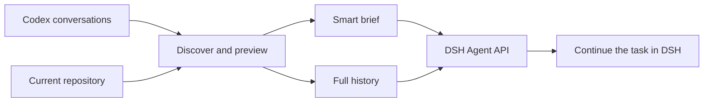

<p align="center">
  
</p>

<h1 align="center">ThreadBridge</h1>
<p align="center"><strong>Your Codex work, continued in DeepSeek Harness.</strong></p>
<p align="center">
  <strong>English</strong> · <a href="README.zh-CN.md">简体中文</a>
</p>
<p align="center">
  <a href="LICENSE"></a>
  
</p>


You have already explained the project, explored the code, and worked through the first few attempts in Codex. When you move to DSH, that context should come with you.

**ThreadBridge brings your Codex conversations, decisions, and current repository context into a DSH session you can keep working in.** Find a conversation, preview the handoff, and pick up the task.

<p align="center"><a href="#why-threadbridge">Why ThreadBridge</a> · <a href="#quick-start">Quick start</a> · <a href="#smart-or-full">Smart or Full</a> · <a href="#how-it-works">How it works</a></p>

## Why ThreadBridge

| What you want to do | What ThreadBridge brings |
| --- | --- |
| Continue a feature in DSH | The goal, decisions, unresolved work, and relevant repository facts. |
| Find a conversation from earlier | Search across active and archived Codex sessions, with previews. |
| Give the next session a focused starting point | Smart handoff combines conversation evidence with the repository's current state. |
| Preserve more of the conversation | Full handoff carries representable message history and completed tool exchanges. |
| Understand the handoff before creating it | A preview of the source, working directory, context, and diagnostics. |

### Context that follows the code

A useful handoff needs more than a summary of what the last agent said. ThreadBridge inspects the working directory and repository so the next session can distinguish earlier intent from the code that is there now.

### A choice in how much to bring

Use **Smart** for a concise continuation brief. Use **Full** when the conversation itself matters. In Smart mode, choose the current DSH model for analysis or build the handoff without an analysis call.

### Continue inside DSH

The result is a normal DSH session created through its Agent API. Open it and keep using the tools and model configured in your DSH environment.

## Quick start

**You need:** a configured DSH Web profile compatible with `0.1.3-alpha.1`, Node 24, Git, and pnpm 11.7.0. Download or clone this repository, then run:

```sh
pnpm install --frozen-lockfile
pnpm build
pnpm pack
dsh plugin --profile web add ./dsh-threadbridge-0.1.0-alpha.1.tgz
```

Restart the DSH Web profile. In the sidebar, open **Continue from Codex**.

1. **Find** the conversation you want to continue.
2. **Preview** its context and select the working directory.
3. **Choose** Smart or Full, review the handoff, and confirm.
4. **Continue** in the new DSH session.

**Try it with a task you know:** select a Codex conversation about a feature you are already building, use Smart, then ask DSH to continue the next unfinished step. Check the preview against your current repository before creating the session.

## Smart or Full?

| | Smart | Full |
| --- | --- | --- |
| Best fit | Get the next session oriented around the work ahead | Carry the conversation's wider history |
| Context | A structured brief: objective, progress, decisions, blockers, next actions, and repository facts | Representable messages and completed tool-call/result pairs |
| Model-assisted analysis | Optional; uses the current DSH model | Not needed for the handoff |
| Historical commands | Used as evidence | Preserved as history |

Historical commands are never replayed during import. Both modes give you a preview and require confirmation.

## How it works



ThreadBridge reads Codex data without modifying it. It compiles the selected context, creates the DSH session, and checks that the session is visible before opening it. Matching source fingerprints make equivalent creation retries idempotent.

## Make it yours

The project separates conversation discovery, repository inspection, context compilation, and the DSH UI. That makes it straightforward to explore a parser improvement, refine the Smart brief, or improve the handoff experience.

```sh
pnpm check
```

Start with the [development guide](docs/DEVELOPMENT.md). For installation details, consent, privacy, recovery, and uninstall instructions, see the [usage guide](docs/USAGE.md).

## Contribute

Found a Codex history format we should handle better? Have an idea for a more useful continuation brief? Open an issue with a synthetic example, or send a focused PR. See [CONTRIBUTING.md](CONTRIBUTING.md).

Built for the [DeepSeek Harness](https://github.com/deepseek-ai/deepseek-harness) ecosystem. [MIT licensed](LICENSE).

<sub>Compatibility and verification details are maintained in the [validation notes](docs/VALIDATION.md); review the handoff before sharing context with your configured model.</sub>
