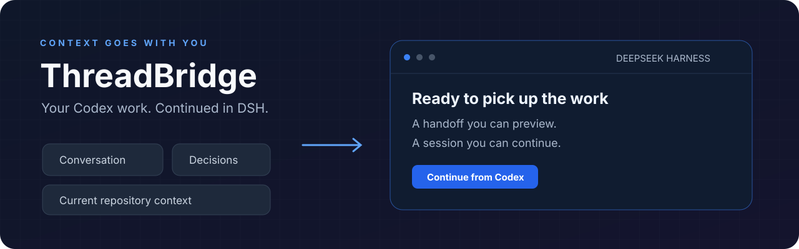
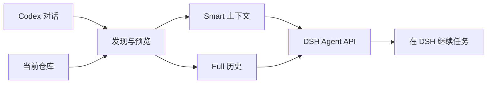

<p align="center">
  
</p>

<h1 align="center">DSH Codex Handoff</h1>
<p align="center"><strong>让 Codex 的工作，在 DeepSeek Harness 继续。</strong></p>
<p align="center">
  <a href="README.md">English</a> · <strong>简体中文</strong>
</p>
<p align="center">
  <a href="LICENSE"></a>
  
</p>


项目背景已经讲过，代码已经读过，方案也试过几轮。切换到 DSH 时，这些上下文应该跟着你一起走。

**DSH Codex Handoff 将 Codex 的对话、决策和当前仓库上下文带入 DSH，让你从已有进展接着做。** 找到会话、预览交接内容，然后继续任务。

<p align="center"><a href="#为什么用-dsh-codex-handoff">为什么用它</a> · <a href="#快速开始">快速开始</a> · <a href="#smart-还是-full">模式选择</a> · <a href="#它是怎么工作的">工作原理</a></p>

## 为什么用 DSH Codex Handoff

| 你想做的事 | DSH Codex Handoff 带来的帮助 |
| --- | --- |
| 在 DSH 中继续一个功能 | 带上任务目标、已有决策、待办工作和相关仓库事实。 |
| 找回之前的一段对话 | 搜索活动与归档 Codex 会话，并预览内容。 |
| 给新会话一个清晰的起点 | Smart 结合会话证据与仓库现状，整理继续工作的上下文。 |
| 保留更完整的讨论过程 | Full 带上可表示的历史消息及已完成的工具交互。 |
| 创建前先确认交接内容 | 查看来源、工作目录、上下文和诊断，再决定导入。 |

### 上下文跟着代码走

一次有用的交接，需要知道“之前打算做什么”，也需要知道“代码现在是什么样”。DSH Codex Handoff 检查实际工作目录和仓库，让新会话获得贴近当前项目的起点。

### 带多少，由你决定

想聚焦接下来的工作，选 **Smart**；需要保留更完整的讨论过程，选 **Full**。Smart 可以调用当前 DSH 模型辅助分析，也可以直接构建无需分析模型的交接内容。

### 接上后，就在 DSH 里继续

DSH Codex Handoff 通过 DSH Agent API 创建普通会话。打开后，直接使用你在 DSH 中配置的模型与工具继续开发。

## 快速开始

**准备环境：** 已配置的 DSH Web profile，兼容 `0.1.3-alpha.1`；Node 24、Git、pnpm 11.7.0。下载或克隆本仓库后执行：

```sh
pnpm install --frozen-lockfile
pnpm build
pnpm pack
dsh plugin --profile web add ./dsh-codex-handoff-0.1.0-alpha.1.tgz
```

重启 DSH Web profile，在侧边栏打开 **从 Codex 继续 / Continue from Codex**。

1. **找到会话**：选择要继续的 Codex 对话。
2. **预览上下文**：检查交接内容，选择实际工作目录。
3. **选择模式**：选 Smart 或 Full，核对后确认创建。
4. **接着开发**：进入新的 DSH 会话，继续未完成的任务。

**第一次可以这样试：** 选一段你正在开发的功能对话，使用 Smart；确认预览与当前仓库一致后创建会话，让 DSH 继续下一项未完成工作。

## Smart 还是 Full？

| | Smart | Full |
| --- | --- | --- |
| 适合场景 | 让新会话快速掌握接下来要做的事 | 带上更广的历史讨论背景 |
| 带入内容 | 目标、进展、决策、阻塞、下一步与仓库事实 | 可表示的历史消息及完整工具调用/结果配对 |
| 模型辅助分析 | 可选，使用当前 DSH 模型 | 交接时无需分析模型 |
| 历史命令 | 作为证据使用 | 作为历史记录保留 |

导入过程不会重新执行历史命令。两种模式都会先展示预览，并由你确认。

## 它是怎么工作的



DSH Codex Handoff 只读访问 Codex 数据，编译选定上下文，通过 DSH 创建会话，并在确认会话可见后打开它。对于来源指纹相同的等价创建请求，重试保持幂等。

## 一起把交接做好

会话发现、仓库检查、上下文编译和 DSH 界面分层组织。你可以从支持更多历史格式、改善 Smart 摘要或优化交接体验中的任一处开始。

```sh
pnpm check
```

开发入口见 [开发指南](docs/DEVELOPMENT.md)；安装细节、授权与隐私、异常恢复和卸载见 [使用指南](docs/USAGE.md)。

欢迎带着合成样例提 issue，或提交聚焦的 PR，详见 [贡献指南](CONTRIBUTING.md)。面向 [DeepSeek Harness](https://github.com/deepseek-ai/deepseek-harness) 生态构建，采用 [MIT 许可证](LICENSE)。

<sub>版本适配与验证情况见 [验证记录](docs/VALIDATION.md)；向当前模型共享上下文前，请核对交接内容。</sub>
