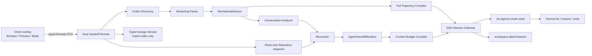

> Historical design document / 历史设计材料。May describe planned or superseded behavior. For current behavior and checks, use the root README and `../VALIDATION.md`.

# dsh-codex-handoff 产品与技术规格

> 状态：MVP implementation-ready
> 研究基线：见 `RESEARCH.md`，DSH `0.1.3-alpha.1` / commit `d347e703…`，Codex commit `de787406…`
> 规范关键词：MUST/必须、SHOULD/应该、MAY/可以按 RFC 2119 语义解释。

## 1. Product

### 1.1 Problem

用户在 Codex 中进行到一半的编码任务，切到 DeepSeek Harness（DSH）后，现有导入器最多复制聊天，不能可靠回答“仓库此刻到底是什么状态、之前哪些做法失败、下一步应做什么”。用户被迫重新解释，或者模型依据过时对话重复错误操作。

本产品把一个 Codex rollout 转为一个**正常、可恢复、可用标准工具继续工作的 DSH session**，并提供两种语义不同的迁移模式：

- **Smart Handoff（默认）**：对话证据 + 实时 Git/filesystem 事实 → 冲突消解 → 有 provenance 的可执行 handoff。
- **Full Trajectory**：保留所有可安全解析和表达的消息/工具轨迹，明确标注缺失、未配对、截断和不支持项。

### 1.2 Personas

- 在同一台机器、同一仓库间切换 Codex 与 DSH 的个人开发者。
- 需要审计历史调用，又要求新 Agent 不重放旧命令的高级用户。
- 维护 DSH 私有/团队部署、关心格式兼容和隐私的插件管理员。

### 1.3 Primary user story

用户打开 DSH，点击 `Continue from Codex`，搜索并预览某个 Codex session，保留/确认 cwd，默认选择 Smart Handoff，创建并打开 DSH session。用户只需发送“继续”或具体下一步，而不必复述目标；DSH 能先核对当前文件和 failing test，再用正常 DSH tools 继续修改原项目。

### 1.4 Non-goals

- 不实现 DSH→Codex 同步或双向实时 bridge。
- 不同步 Codex 配置、MCP、skills、memory、账号或 credentials。
- 不实现 Claude Code/OpenCode 等额外 source；只预留接口。
- 不恢复或解密 `encrypted_content`，不承诺还原已不存在的原始 compacted history。
- 不把 DSH 与 Codex 的 tool schema 一一等同，不重放历史工具/approval。
- 不自动执行 tests、构建、Git 写操作或文件修改。
- 不做跨机器/云上传、全仓库索引、后台持续同步。
- 不依赖未验证的 DSH 顶级页面路由；MVP 是 sidebar action + overlay。

### 1.5 MVP scope

必须完成：

1. Windows/macOS/Linux 的 Codex home 解析（配置覆盖 → `CODEX_HOME` → OS home/.codex）。
2. active 与 archived rollout 发现、最近排序、分页、文本搜索、source metadata/title/cwd 摘要；支持 plain/`.jsonl.zst`、stable thread/revert revision 和 recursive `history_base` logical-thread resolution。
3. 流式、容错、大小与递归受限的当前 Codex parser，支持消息、可读 reasoning summary、function/custom tool pair、compacted message；未知类型诊断与 complete/partial/corrupt/unsupported 分类。
4. Session browser、preview、Smart/Full mode selector；Smart 默认；大 Full 警告/显式确认。
5. 确定性只读 Repository Inspector。
6. Smart extractor、正式 truth hierarchy、manifest schema、token-budget compiler、无 LLM fallback。
7. 通过自有 typed Remote 在 Host 调用 `ctx.agents.create({ seed, ... })`，正确 cwd、preset/model composition、workspace attach、source metadata、幂等 revision。
8. 创建后刷新列表并 `ctx.sessions.open(id)`；真实 create/list/load/resume/normal tool continuation 验证。
9. 双语 locale、loading/empty/error/cancel/large/missing-cwd/degraded 状态。
10. 安装包、README、兼容性说明、fixtures/tests 和独立验收材料（由后续 workstreams 完成）。

MVP 可以降级但必须显式显示：

- 当前模型不可用时，Smart 使用 deterministic extractor；
- cwd 是有效非 Git 目录时，不提供 branch/diff，但仍生成 filesystem-aware manifest；
- workspace service attach 失败时 session 保留并打开，标为 `created_unattached`；
- Smart preview 生成失败不能阻塞创建，用户可直接创建 degraded manifest。

MVP 不得降级的核心：正确 cwd、Codex 源只读、repo inspector 只读、历史工具不执行、session 持久化且可 resume、冲突时当前 repo 事实优先。

## 2. Existing ecosystem

### 2.1 Positioning

`dsh-codex-migrate` 是宽泛的配置/内容迁移和 bridge；`dsh-plugin-session-import` 是多源 session 导入；`dsh-import-agents` 是多 Agent 轨迹同步。本产品只做 Codex→DSH，但在“仓库真相、冲突消解、失败尝试、可执行下一步”上更深。

详细 commit、代码证据和矩阵见 `RESEARCH.md`。硬性结论是：三个参考实现当前均不能作为 DSH persistence 实现来源；任何 `version: 0` 物理写入都禁止进入本项目。

### 2.2 Reuse policy

可以借鉴：发现与索引策略、callId 配对、增量 fingerprint、workspace UX、typed Remote 和 locale 模式。

禁止复制：物理 session writer、format v0 event builder、以最后一个 SessionMeta 定根、正则修复 JSON 参数、伪造 tool result、随机 id 导致重复导入、未经 schema 的 LLM 摘要。

## 3. Architecture

### 3.1 Component diagram



### 3.2 Data flow

1. Client requests `discover`/`search`; Host scans only configured Codex session roots and returns bounded summaries.
2. `preview` loads one rollout through parser; result includes counts, diagnostics and size estimate, never unbounded raw content.
3. Client supplies selected source id, expected fingerprint, mode, confirmed cwd and options to `create`.
4. Host reloads source and compares fingerprint (TOCTOU guard); validates/canonicalizes cwd.
5. Full: normalized events → balanced DSH seed. Smart: conversation analyzer + repo inspector → claims → reconciler → schema-valid manifest → budgeted kickoff → balanced DSH seed.
6. Gateway computes deterministic import key/session id, checks existing plugin index and DSH query, composes current preset/default model like official Session Controller, then calls `ctx.agents.create`.
7. On success it durably records import mapping, resolves/creates workspace, attaches, and returns state.
8. Client refreshes the authoritative session list and opens the id. No historical action executes in any step.

### 3.3 Module boundaries

Proposed source topology (actual filenames may vary only if ownership remains equivalent):

```text
src/
  shared/       # DTOs, domain types, schemas, errors; browser-safe
  codex/        # home resolution, discovery, index, stream parser, normalization
  repo/         # Git/filesystem read-only adapters and RepositoryState
  handoff/      # extraction, claims, reconciliation, manifest, budget/compiler
  dsh/          # seed conversion, Agent/preset/workspace/import-index gateway
  host/         # Typert Remote service, validation, orchestration, apply
  client/       # slots, overlay UI, state machine, locale
tests/
  fixtures/     # synthetic/redacted; no copied real local sessions
```

### 3.4 Dependency rules / import direction

```text
shared <- codex
shared <- repo
shared <- handoff
shared <- dsh
shared <- host <- client only through Remote contract package/types
codex + repo -> handoff -> dsh -> host
```

Rules：

- `shared` MUST NOT import Node, React, Cordis, DSH runtime or feature modules.
- `codex` and `repo` MAY import Node stdlib and `shared`; MUST NOT import DSH/React or each other.
- `handoff` MAY import `shared` types and DSH LLM abstractions only through injected ports; MUST NOT read filesystem or call Git directly.
- `dsh` MAY import DSH Host packages and `shared`; MUST NOT import Client/React or concrete parser internals.
- `host` is composition root; it MAY depend on all Host modules but contains no business algorithms.
- `client` MAY import browser-safe `shared` Remote DTOs and DSH Client packages; MUST NOT import `node:*`, Host implementations, parser, repo or DSH Host packages.
- Tests may import the subject under test; production modules MUST NOT import tests/fixtures.
- Cross-workstream types are defined once in `shared`; no duplicated “almost same” interface.

### 3.5 Runtime capabilities

Required Host services: `agents`, registered agent factory/loop, `agentDefaultModel`, `sessionQuery`, `sessionPersistence`, `workspaceRegistry`, `storageDomain`, `typert`; `llm` is optional for degraded Smart but required for enhanced Smart. Required Client services: `slots`, `remote`, `sessions`, `locale`, React runtime.

Startup compatibility probe returns exact booleans and DSH format observation. Missing required create/list/resume capability disables the Create button with `DSH_INCOMPATIBLE`; it never falls back to raw persistence.

## 4. Data models

The following is the normative logical contract. Implementation SHOULD use Zod (or DSH-standard equivalent) as the single runtime/type source and expose readonly values.

### 4.1 Shared primitives

```ts
type IsoDateTime = string
type SessionSourceKind = 'codex'
type HandoffMode = 'smart' | 'full'
type Severity = 'info' | 'warning' | 'error'

interface Diagnostic {
  code: string
  severity: Severity
  message: string             // sanitized, user-safe
  record?: { line?: number; ordinal?: number; type?: string }
  recoverable: boolean
}
```

No DTO contains native Error, Buffer, stream, absolute Codex JSONL filename, raw secret, or unbounded text.

### 4.2 Discovery models

```ts
interface ExternalSessionSummary {
  discoveryId: string          // opaque Host-issued handle; never a path
  source: 'codex'
  sessionId: string            // stable logical thread id
  rolloutRevisionId: string    // selected immutable head rollout id
  fingerprint: string
  title?: string
  cwd?: string
  startedAt?: IsoDateTime
  updatedAt: IsoDateTime
  archived: boolean
  cliVersion?: string
  messageCount: number
  toolCallCount: number
  byteSize: number
  parseHealth: 'complete' | 'partial' | 'corrupt' | 'unsupported'
}

interface SessionPage {
  items: ExternalSessionSummary[]
  nextCursor?: string          // opaque, Host-signed/versioned or index-based
  scannedAt: IsoDateTime
}
```

Search is case-insensitive over bounded title/sessionId/cwd basename and, only when explicitly requested, the Host’s bounded message index. The Client never receives a full transcript for list search.

### 4.3 NormalizedSession

```ts
interface NormalizedSession {
  schemaVersion: 1
  source: {
    agent: 'codex'
    sessionId: string          // stable logical thread id
    rolloutRevisionId: string  // selected immutable revision
    fingerprint: string
    title?: string
    cwd?: string
    cliVersion?: string
    startedAt?: IsoDateTime
    updatedAt?: IsoDateTime
    archived: boolean
  }
  lineage: Array<{
    rolloutRevisionId: string
    relation: 'head' | 'history-base'
    endOrdinalExclusive?: number
    representation: 'jsonl' | 'jsonl.zst'
  }>
  timeline: NormalizedEvent[]
  diagnostics: Diagnostic[]
  completeness: {
    malformedLines: number
    unknownRecords: number
    droppedEncryptedBlocks: number
    danglingToolCalls: number
    orphanToolResults: number
    truncatedRecords: number
  }
}

type NormalizedEvent =
  | { kind: 'message'; id: string; order: number; at?: IsoDateTime;
      role: 'user' | 'assistant' | 'system'; text: string;
      phase?: 'commentary' | 'final_answer'; source: SourceRef }
  | { kind: 'reasoning-summary'; id: string; order: number; at?: IsoDateTime;
      text: string; source: SourceRef }
  | { kind: 'tool-call'; id: string; order: number; at?: IsoDateTime;
      callId: string; name: string; argumentsText: string; source: SourceRef }
  | { kind: 'tool-result'; id: string; order: number; at?: IsoDateTime;
      callId: string; name?: string; content: string; failed?: boolean; source: SourceRef }
  | { kind: 'compacted'; id: string; order: number; at?: IsoDateTime;
      summary: string; source: SourceRef }
  | { kind: 'annotation'; id: string; order: number; at?: IsoDateTime;
      category: 'incomplete-tool' | 'unsupported' | 'boundary'; text: string; source: SourceRef }
```

`order` is parser-stable chronological order using ordinal when valid, otherwise physical line order. Duplicates are removed only by exact source locator + canonical content hash, never semantic guesswork.

### 4.4 RepositoryState

```ts
interface RepositoryState {
  observedAt: IsoDateTime
  cwd: { requested: string; canonical: string; exists: boolean; writable?: boolean }
  git?: {
    repoRoot: string
    branch?: string
    detached: boolean
    head: string
    dirty: boolean
    modified: PathChange[]
    added: PathChange[]
    deleted: PathChange[]
    renamed: PathChange[]
    untracked: PathChange[]
    staged: string[]
    unstaged: string[]
    recentCommits: Array<{ hash: string; subject: string; authoredAt: IsoDateTime }>
  }
  relevantPaths: Array<{
    path: string             // repo-relative when in repo
    exists: boolean
    kind?: 'file' | 'directory' | 'symlink' | 'other'
    size?: number
    observedAt: IsoDateTime
  }>
  diagnostics: Diagnostic[]
}

interface PathChange {
  path: string
  oldPath?: string
  index: boolean
  worktree: boolean
}
```

Git values come only from deterministic commands with argv arrays, `-C canonicalCwd`, no shell interpolation, timeouts/output caps. `dirty` derives from porcelain status, never from LLM.

### 4.5 Claims and provenance

```ts
type ProvenanceKind = 'conversation' | 'tool-result' | 'git' | 'filesystem' | 'inferred'

interface ProvenanceRecord {
  id: string
  kind: ProvenanceKind
  locator: string            // e.g. rollout ordinal, callId hash, repo-relative path
  observedAt?: IsoDateTime
  assertedAt?: IsoDateTime
  confidence: 'high' | 'medium' | 'low'
  redacted: boolean
}

interface Claim<T = unknown> {
  id: string
  subject: string
  predicate: string
  value: T
  status: 'current' | 'superseded' | 'unverified' | 'historical'
  sourceIds: string[]
  order?: number
}
```

### 4.6 AgentHandoffManifest

```ts
interface AgentHandoffManifest {
  schemaVersion: '1.0.0'
  generatedAt: IsoDateTime
  mode: 'smart'
  source: {
    agent: 'codex'
    sessionId: string
    rolloutRevisionId: string
    fingerprint: string
    title?: string
    startedAt?: IsoDateTime
    updatedAt?: IsoDateTime
  }
  objective: ManifestText
  workspace: {
    cwd: string
    repoRoot?: string
    branch?: string
    detached?: boolean
    head?: string
    dirty?: boolean
  }
  progress: {
    completed: WorkItem[]
    inProgress: WorkItem[]
    blocked: WorkItem[]
  }
  decisions: Decision[]
  failedAttempts: FailedAttempt[]
  currentProblems: Problem[]
  relevantFiles: RelevantFile[]
  repositoryChanges: {
    modified: string[]; added: string[]; deleted: string[];
    renamed: Array<{ from: string; to: string }>;
    untracked: string[]; staged: string[]; unstaged: string[]
  }
  verification: {
    commandsRun: CommandRecord[]
    testsPassed: VerificationItem[]
    testsFailed: VerificationItem[]
    latestStatus: 'passing' | 'failing' | 'mixed' | 'unknown'
    buildStatus?: 'passing' | 'failing' | 'unknown'
  }
  constraints: ManifestText[]
  openQuestions: ManifestText[]
  nextActions: ActionItem[]
  provenance: ProvenanceRecord[]
  completeness: NormalizedSession['completeness'] & {
    analyzer: 'dsh-model' | 'deterministic-fallback'
    omittedByBudget: Record<string, number>
  }
  diagnostics: Diagnostic[]
}

interface ManifestText { text: string; sourceIds: string[]; confidence: 'high'|'medium'|'low' }
interface WorkItem extends ManifestText { id: string; status: 'completed'|'in-progress'|'blocked'|'historical' }
interface Decision extends ManifestText { id: string; rationale?: string; status: 'active'|'superseded' }
interface FailedAttempt extends ManifestText { id: string; reason?: string; currentRepoPresence: boolean|'unknown' }
interface Problem extends ManifestText { id: string; severity: 'blocking'|'non-blocking'|'unknown' }
interface RelevantFile extends ManifestText { path: string; exists: boolean; change?: string }
interface CommandRecord extends ManifestText { commandSummary: string; result: 'passed'|'failed'|'unknown'; at?: IsoDateTime }
interface VerificationItem extends ManifestText { name: string; at?: IsoDateTime }
interface ActionItem extends ManifestText { id: string; priority: number; requiresVerification?: boolean }
```

Schema invariants：

- 所有 key facts 至少一个 `sourceIds`；纯推断必须指向 `kind: inferred` 并为 medium/low。
- path 是 canonical cwd 内的绝对路径或 repo-relative path；展示/LLM 使用 repo-relative 优先。
- `repositoryChanges` 只从 Git state 生成，LLM 不可写入。
- `currentRepoPresence=false` 的失败尝试必须渲染为 “Historical attempt no longer present in current repository.”
- 每个 `sourceId` 必须在 provenance 中存在；未知额外字段 reject，缺少必填字段 reject。

### 4.7 DSH integration model

```ts
interface ImportIdentity {
  key: string // sha256(source, stable thread, rollout revision, fingerprint, mode, canonicalCwd, compilerSchema)
  destinationSessionId: string // session-codex-handoff-<first 32 hex>
}

interface ImportRecord {
  schemaVersion: 1
  key: string
  sourceSessionId: string
  sourceRolloutRevisionId: string
  sourceFingerprint: string
  mode: HandoffMode
  cwd: string
  destinationSessionId: string
  state: 'prepared'|'creating'|'created'|'created_unattached'|'failed'|'orphaned'
  sourceFingerprintBefore: string
  sourceFingerprintAfter?: string
  attemptId: string
  createdAt: IsoDateTime
  updatedAt: IsoDateTime
}
```

ImportRecord 存于插件拥有、Zod 校验、版本化的 `ctx.storageDomain`，不写入 Codex home。它是幂等索引，不是 DSH session 真相；采用 DSH query 复核 destination 存在性。每次状态改变是一个整 record 的原子 durable put。DSH persistence 与 storage-domain 不存在跨域 ACID，因此流程是显式 saga：`prepared` → fingerprint-after-read → `creating` → DSH create/query → `created` → workspace attach → `created|created_unattached`。崩溃留下中间态时，恢复器先 query destination 和重新 fingerprint，再 adopt、标 `orphaned` 或安全 retry，绝不盲建第二份。

Durable import index 是审计/幂等基线。Session 自身的 source metadata 使用**已存在的 v2 surface vocabulary**：Smart kickoff header、Full 的首个短 plugin-source notice 都包含 sourceAgent、stable thread id、rollout revision id、fingerprint、mode 和 compiler schema，不含本机源文件路径。自定义 log-only `codex-handoff/import` event 只是可选增强：只有真实 seed spike 证明 declaration merging、`ignorable:true`、persistence read、未知-reader resume 全链兼容后才可启用；否则不得写入。禁止扩展 `SessionHeader`。

## 5. Interfaces

### 5.1 Session source abstraction

```ts
interface SessionSource {
  readonly kind: SessionSourceKind
  discover(query: DiscoverQuery, signal: AbortSignal): Promise<SessionPage>
  preview(ref: ExternalSessionRef, limits: ParseLimits, signal: AbortSignal): Promise<SessionPreview>
  load(ref: ExternalSessionRef, limits: ParseLimits, signal: AbortSignal): Promise<NormalizedSession>
}

interface ExternalSessionRef {
  discoveryId: string          // opaque, bound to inventory generation
  source: 'codex'
  sessionId: string
  rolloutRevisionId: string
  expectedFingerprint?: string
  archived?: boolean
}
```

MVP 只有 `CodexSessionSource`。Registry 可以支持未来 provider，但第一版不得实现或宣传其他源。

### 5.2 Ports

```ts
interface RepositoryInspector {
  inspect(cwd: string, relevantPaths: string[], signal: AbortSignal): Promise<RepositoryState>
}

interface ConversationAnalyzer {
  analyze(session: NormalizedSession, redactedEvidence: EvidenceBundle,
          signal: AbortSignal): Promise<AnalysisClaims>
}

interface StateReconciler {
  reconcile(session: NormalizedSession, claims: AnalysisClaims,
            repository: RepositoryState): AgentHandoffManifest
}

interface ContextCompiler {
  compile(manifest: AgentHandoffManifest, budget: TokenBudget): CompiledContext
}

interface DshSessionGateway {
  create(request: PreparedImport, signal: AbortSignal): Promise<CreateOutcome>
  find(identity: ImportIdentity, signal: AbortSignal): Promise<string | undefined>
}
```

### 5.3 Typed Remote contract

Remote namespace: `codexHandoff`，使用 DSH `TypertRemoteService` / `@Remote`，不手写 fetch route。

```ts
interface CodexHandoffRemote {
  compatibility(): Promise<CompatibilityView>
  discover(req: DiscoverRequest, signal: AbortSignal): Promise<SessionPage>
  preview(req: PreviewRequest, signal: AbortSignal): Promise<SessionPreview>
  analyze(req: AnalyzeRequest, signal: AbortSignal): Promise<SmartPreview>
  create(req: CreateRequest, signal: AbortSignal): Promise<CreateOutcome>
}

interface CreateRequest {
  source: ExternalSessionRef
  mode: 'smart'|'full'
  cwd: string
  expectedFingerprint: string
  consent: {
    disclosureVersion: string
    accepted: true
    acceptedMode: 'smart'|'full'
    modelAnalysis: boolean
  }
  smart?: { targetTokens?: number; useModel?: boolean }
  full?: { confirmedLarge?: boolean }
}

type CreateOutcome =
  | { state: 'created'|'existing'; sessionId: string; workspaceAttached: boolean; warnings: Diagnostic[] }
  | { state: 'created_unattached'; sessionId: string; workspaceAttached: false; warnings: Diagnostic[] }
```

Every boundary performs runtime validation. Remote errors use stable codes; messages are sanitized and detail never includes raw arguments/transcript/secret/path outside confirmed cwd.

### 5.4 UI state machine

```text
closed -> discovering -> browsing -> previewing -> ready
ready -> analyzing -> smartPreview -> creating -> created -> opening -> closed
ready ---------------------------> creating (preview skip)
any request state -> cancelled -> previous stable state
any request state -> error -> retryable previous state
```

Only one create request may be active per modal. Double click is disabled and Host import key guarantees idempotency.

## 6. Codex discovery and parser specification

### 6.1 Roots, representations and opaque addressing

- `codexHome` config, if present, MUST be absolute and canonicalizable.
- Else use non-empty `CODEX_HOME`; else OS home + `.codex`.
- Scan only `sessions/**/rollout-*.jsonl`, their `*.jsonl.zst` siblings, and—when archive filter allows—equivalent `archived_sessions/**` files. Temporary compression names are ignored.
- Plain `.jsonl` and compressed `.jsonl.zst` are two representations of one rollout, not two revisions. If both exist, follow the current official resolution precedence and verify stat/realpath before and after open; retry a bounded number of times across a compression transition.
- Refuse symlink/junction escape from these roots; do not scan `auth.json`, databases, logs, `.env` or arbitrary home files.
- Discovery returns an opaque `discoveryId` bound to root, logical thread, selected revision and inventory generation. Client never sends or learns a source path. Host resolves it afresh, calls realpath/containment checks, and rejects stale/forged handles.
- First valid `session_meta` is canonical. `SessionMeta.id` is stable logical thread id; filename-derived rollout id identifies an immutable revision. Filename uuid is locator/fallback, not permission to merge unrelated threads.
- `session_index.jsonl` latest valid row per id supplies display title only.

### 6.2 CodexLogicalThreadResolver

Discovery groups rollout files by stable thread id, then selects the logical head. A normal thread usually has one revision. `thread/revert` retains the stable thread id and writes a new filename with a distinct `_rollout-id`; filesystem fallback chooses the newest matching revision, preferring an active representation over archived only when the same stable thread is actually present in active storage. Ambiguous active/archive duplicates are `partial`, not silently merged.

The resolver reconstructs history recursively through `SessionMeta.history_base`：

1. Resolve `history_base.thread_id` as a **rollout revision id** across active, archived, plain and compressed storage—not automatically as a logical parent thread.
2. Read only the referenced prefix `[0, end_ordinal_exclusive)` and then append the child/current revision’s owned suffix in ordinal order.
3. Preserve the selected head revision id and every lineage edge in `NormalizedSession.lineage`.
4. Detect visited rollout-id loops, missing bases, decreasing/invalid cutoffs, overlapping ordinals and duplicate representations.
5. A true fork is determined by explicit fork metadata/cutoff rules; `history_base` alone after revert is not proof of parentage.

Hard resolver limits：maximum 32 history-base edges, 64 physical rollout representations, 512 MiB decompressed aggregate input, 1,000,000 aggregate records and the existing per-file/line caps. A limit hit yields `partial` with a precise missing-prefix diagnostic if a usable head remains; no usable canonical head is `corrupt`; recognized but semantically unsupported lineage is `unsupported`.

Health definitions：

- `complete`：head and every required prefix resolved and parsed within limits；
- `partial`：usable chronology exists but some lines/prefixes/unknown records are omitted with diagnostics；
- `corrupt`：no trustworthy canonical identity/head or chronology can be constructed；
- `unsupported`：input is structurally readable but requires semantics this plugin version cannot preserve。

### 6.3 Limits

Normative defaults (configurable downward/upward within documented hard caps):

| Limit | Default | Hard maximum |
|---|---:|---:|
| discover results/page | 50 | 200 |
| files scanned/request | 5,000 | 20,000 |
| line bytes | 2 MiB | 8 MiB |
| source file bytes | 256 MiB | 1 GiB |
| logical-chain decompressed bytes | 256 MiB | 512 MiB |
| logical-chain depth/files | 16 / 32 | 32 / 64 |
| records/session | 250,000 | 1,000,000 |
| normalized message text | 256 KiB | 1 MiB |
| normalized tool result | 128 KiB | 1 MiB |
| preview snippet | 2 KiB | 8 KiB |

超过 hard maximum 时 stop/recover with diagnostic，不 OOM、不静默成功。解析使用 backpressure 和 AbortSignal。

### 6.4 Mapping

- message: user/assistant 输出进入 timeline；developer/system 环境包默认不作为用户对话，仅可由 constraint extractor 读取 allowlisted 明确规则。
- reasoning: 只取 summary/readable text；encrypted content 计数并丢弃。
- function/custom calls: 保留原始 argument string（大小受限），不正则改写；结果按 callId 精确配对。
- local shell/web/tool-search: 在能建立真实 call/result 语义时标准化，否则 annotation + diagnostic。
- compacted: 保存 summary；replacement history 仅当当前官方形状能完整验证时采用。
- unknown event: diagnostic，不变成 assistant text。
- malformed line: diagnostic；若 identity/timeline 其余有效则 partial recovery。
- ordinal cut occurs before normalization；events beyond a base edge’s `end_ordinal_exclusive` MUST NOT leak into the logical thread。

## 7. Repository Inspector

### 7.1 Deterministic observation

检查：cwd existence/canonical path；Git root；branch 或 detached；HEAD；porcelain-v2 `-z` 状态；staged/unstaged/untracked/rename；bounded recent commits；对 conversation 提及的 bounded relevant paths 做 lstat/stat。

建议 Git argv（实现必须使用 process API + argv，不拼 shell）：

- `git -C <cwd> rev-parse --show-toplevel`
- `git -C <cwd> symbolic-ref --quiet --short HEAD`
- `git -C <cwd> rev-parse HEAD`
- `git -C <cwd> status --porcelain=v2 -z --untracked-files=all`
- `git -C <cwd> diff --cached --name-status -z`
- `git -C <cwd> diff --name-status -z`
- `git -C <cwd> log -n <N> --format=<bounded machine format>`

Global safe options/env disable pager, color, external diff, text conversion, credential prompting and optional locks. Every user/source-derived pathspec follows a literal `--` terminator (or is handled by filesystem APIs) and is never parsed as an option. No Git command may write, fetch, checkout, reset, clean, add, commit, stash or execute hooks. Each process has timeout, output byte cap and cancellation.

### 7.2 Relevant content

Default Smart input includes path/status/existence and bounded verification output from transcript, not arbitrary file content. Optional relevant-file excerpts are allowed only when path is inside canonical cwd/repo, not denied/sensitive, text-like, below size cap, and required to resolve a claim; every excerpt is redacted and recorded in provenance. No recursive whole-repo read.

Non-Git cwd is valid: `git` absent with diagnostic; filesystem existence facts still participate. Missing cwd blocks creation until user selects an existing directory.

## 8. Full Trajectory specification

### 8.1 Semantics

Full Trajectory means all source records that are (a) parseable, (b) safe to expose, and (c) representable as a valid balanced DSH seed. It is not byte-for-byte archival and never claims to preserve encrypted/unknown/malformed content.

Chronology follows normalized order. User/assistant messages retain roles; readable reasoning summary may be represented as assistant-readable summary with source marker, never as private chain-of-thought. Exact paired historical tool calls/results become DSH call/result history with preserved callId mapping and truncated-content marker when needed.

Historical tool records are inert seed. Import MUST NOT submit the events to a live turn, command runner, tool registry, approval service or Agent driver. No model call is required for Full.

### 8.2 Seed invariants

- seq starts 0 and increments by 1.
- all turns/steps end; no dangling call.
- one source callId maps to one collision-safe DSH callId.
- orphan result is excluded from tool events and represented only in diagnostic/annotation.
- dangling call is represented as plain text “Historical tool call had no recorded result; it was not executed.”
- no fabricated result, status, command output, success or failure.
- source metadata baseline is a recognized `user/message` plugin notice; optional custom audit event is feature-probed, never required for resume.
- title derives from source title then first bounded user message, with locale-safe truncation.

### 8.3 DSH v2 exact mapping contract

Seed compiler is not considered implemented until a real `Session.create`/`ctx.agents.create` spike accepts the exact output, derives the expected model history, persists it and resumes it. The spike freezes a golden event sequence at the supported DSH commit.

| Source unit | Required v2 output | Required fields / policy |
|---|---|---|
| start of imported interaction | `turn/start` | 1-based monotonically increasing `turn`; event `seq` contiguous from 0; safe integer `time` from source or deterministic fallback |
| source metadata | `user/message` + `surfaceOp:'append'` | stable deterministic message id; role user; source `{kind:'plugin', plugin:'dsh-codex-handoff', form:'notice'|'snapshot', ...}` |
| original human message | `user/message` + append | identified message, role user, source `{kind:'user'}`; adjacent source user items may share one turn only when chronology is unambiguous |
| model step | `step/start` | same turn; 1-based step; precedes assistant/tool events |
| assistant final item | `assistant/message` + append | deterministic message id; `turn/step`; source `{kind:'model', provider, model}` from canonical source metadata, or explicit `codex-import`/`unknown` labels; content preserves text/reasoning-summary/tool-call blocks |
| assistant stream | `assistant/message.data.stream` | Codex final `response_item` is not a DSH delta stream. Baseline is `[]` (unknown original stream), not fabricated deltas/finish. If future Codex source supplies exact deltas, use `AssistantStreamAccumulator`-compatible records and prove roundtrip |
| assistant usage/finish | optional `usage`; stream finish only if exact | map only per-response usage/finish with equivalent semantics. Cumulative `token_usage_record` is not attached to a message; unknown finish/usage are omitted, never guessed |
| tool request | assistant `tool-call` block **and** log-only `tool/call` | deterministic collision-safe `ToolCallId`; exact tool name and raw argument string; `tool/call` has no `surfaceOp` |
| tool completion | `tool/result` + append | same turn/step/callId; identified tool-result message with source `{kind:'tool', callId}` and tool-result content block; `error`/`isError` only from explicit source failure |
| end model step | `step/end` | after all calls/results for the step; no dangling call |
| end interaction | `turn/end` | same turn; `reason:{kind:'completed'}` only for a source interaction known complete; an open/crash-truncated source turn closes as `{kind:'interrupted'}` after dangling tools were downgraded to annotation, never as false success |

All surface-eligible events (`user/message`, `assistant/message`, `tool/result`) MUST carry `surfaceOp:'append'`; log-only boundaries and `tool/call` MUST NOT. `sourceEventSeqs` is omitted for ordinary append events. `request/header` is not synthesized because the source DSH request did not exist; the first real post-import DSH request writes its own header. `assistant/attempt` is emitted only when the Codex source contains a separately settled non-surface attempt that can be represented honestly; otherwise failed approaches remain manifest/text, not fake model attempts. `session/end-seed` is constructor-owned and MUST NOT appear in the supplied seed.

Imported history is replay context, **not a DSH fork prefix**：`meta.isSeeded`, `meta.parentSession` and `inheritedEventCount` MUST be omitted. Passing a non-empty constructor `seed` does not mean fork lineage. The compiler validates every deterministic message/call id, seq, time, turn/step bracket, surface marker, model source, JSON value, stream, usage and call pairing before `ctx.agents.create`.

### 8.4 Size protection

Preview reports message/tool counts, bytes, estimated tokens and largest records. Estimate uses target model tokenizer if DSH exposes a validated tokenizer; otherwise conservative UTF-8/character estimator with `estimator: fallback`.

Defaults：warning at 32k estimated tokens or 16 MiB normalized content; hard safety at 128k tokens or 64 MiB output seed (configurable within absolute process caps). Above warning requires `confirmedLarge=true`. Above hard safety refuses `TRAJECTORY_TOO_LARGE`; UI recommends Smart. It must not silently switch modes.

Per-record truncation uses explicit marker and completeness count. If limits prevent faithful balanced seed, refuse instead of emitting invalid partial turns.

## 9. Smart Handoff specification

### 9.1 Pipeline

```text
load/normalize -> redact/select evidence -> conversation claims
             + -> deterministic repo observation
             -> reconcile -> schema validate -> budget compile -> DSH seed
```

### 9.2 Conversation analysis

Extract：objective、completed/in-progress/blocked、decisions+rationale、failed attempts+reason、problems、constraints、open questions、verification commands/results、candidate relevant files、next actions。

Enhanced analyzer explicitly obtains `{provider, model}` from `ctx.agentDefaultModel.currentSelection()` and calls that route through `ctx.llm.stream()` with no tools and no novel `purpose`; it does not ask for a second API key. It does not infer selection from arbitrary UI text. Input is redacted/bounded evidence framed as untrusted data. Output is strict JSON matching an intermediate schema. Invalid JSON/schema, refusal, timeout, max-token, empty output or unavailable model triggers deterministic fallback and warning.

Deterministic fallback extracts explicit user objectives/constraints, latest status/test tool results, changed paths and recency-based action candidates. It must not invent decisions/reasons. Empty sections remain empty/unknown, not hallucinated.

LLM output is candidate evidence, never authoritative Git/filesystem facts. Model cannot add paths that were neither mentioned nor observed without `inferred` provenance.

### 9.3 Kickoff context

Compiled context uses a normal DSH user-role message with source:

```ts
{ kind: 'plugin', plugin: 'dsh-codex-handoff', form: 'snapshot', sections: [...] }
```

It is seeded in a balanced completed turn and does not immediately run the model. Opening the session may prefill a local draft such as “Continue from this handoff” but MUST require an explicit user submit before model/tool execution.

Rendered structure：

```md
# Handoff from Codex
## Objective
## Current repository
## Completed
## In progress
## Current problems
## Important decisions
## Failed approaches
## Relevant files
## Verification
## Constraints and open questions
## Next actions

Treat the current filesystem and Git state as authoritative.
Inspect relevant files before changing them.
Do not repeat previously failed approaches unless new evidence justifies it.
```

Each item MAY show compact `[source: …]` labels; full internal provenance need not consume all model tokens but remains in manifest/preview. Omitted sections display `(none observed)` or `(unknown)`, never implied success.

Smart preview is SHOULD: if analysis succeeds, show objective/current repo/blockers/next actions and degraded/omission warnings before create. User may skip it; failure does not block deterministic creation.

## 10. Reconciliation

### 10.1 Truth hierarchy

Formal precedence, applied only to the same predicate/scope：

1. **Current filesystem / Git** — authoritative for observable current facts: path existence, content/hash when explicitly read, branch, HEAD, dirty/change category.
2. **Latest verified tool result** — authoritative for the command/test/build’s observed result at that timestamp/scope.
3. **Latest user statement** — authoritative for intent, requirements, priorities and user-owned constraints.
4. **Latest assistant statement** — candidate state/decision when not contradicted.
5. **Historical assistant statement** — background only.

Inference never overrides direct evidence. Repository facts do not override product intent; a clean Git status cannot prove a feature is complete.

### 10.2 Ordering and conflict rules

- Same source tier: later asserted/observed order wins when scope matches.
- A later successful verification supersedes an older failure for `latestStatus`, while the older failure stays in history if it explains a failed approach.
- Conversation says file modified, current Git says unchanged: current change claim is `superseded`; describe “Historical attempt no longer present in current repository.”
- Conversation says file exists, lstat says missing: current relevant file has `exists=false`; preserve historical mention.
- User intent conflicts with assistant plan: user wins; assistant plan becomes superseded, not next action.
- Conflicting verified commands with different scopes are both retained; no false global status.
- Unresolvable conflict produces `unverified` plus open question; never choose by prose confidence alone.

Reconciler is pure and deterministic. Given the same normalized session, repository state and candidate claims, output must be byte-stable apart from `generatedAt`/stable ids (tests inject clock/id source).

## 11. Context budgeting

### 11.1 Budget

Default target 6,000 tokens; user configurable 4,000–8,000 in UI, Host hard range 2,000–16,000. If model context window is known, target is additionally capped to `min(requested, max(2000, floor(contextWindow * 0.10)))`; target never consumes the model’s whole context.

Estimator order: validated DSH/adapter tokenizer if publicly available; otherwise conservative fallback. Compiler reserves 10% or at least 400 tokens for headings, safety directives and omission summary.

### 11.2 Priority order

Atomic items are sorted by tier then actionability/recency/confidence:

1. safety directives, explicit user constraints, objective, cwd/repo/branch/HEAD;
2. current blockers/problems, failing latest verification, next actions;
3. dirty/staged/unstaged/untracked changes and existence of relevant files;
4. active decisions and in-progress work;
5. failed attempts needed to avoid repetition;
6. completed work and passing verification;
7. open questions and compact provenance labels;
8. background/history.

No atomic required fact is cut mid-item. Oversized text is summarized deterministically with a hash/omission marker, not raw prefix that changes meaning. Deduplicate equivalent facts before truncation. Compiler writes per-section `omittedByBudget` counts and a final omission note.

If tiers 1–3 cannot fit 2,000 tokens, create fails with `SMART_CONTEXT_CANNOT_FIT` rather than remove safety/objective/current blocker.

## 12. DSH session creation

### 12.1 Required create path

Gateway MUST mirror official Session Controller composition:

1. Resolve requested/default Agent preset through `ctx.agentPresets.resolve(...)` when available and mount it in setup with `ctx.agentPresets.mount(agentCtx, resolvedId)`; do not merely stamp the id in metadata.
2. Obtain `{provider, model}` from `ctx.agentDefaultModel.currentSelection()`.
3. Compose `setup` to mount preset into `agentCtx` before publication.
4. Call `ctx.agents.create({ sessionId, seed, meta:{cwd, agentPreset?}, agentOptions, setup, signal })`.
5. Hold the returned AgentHandle for the live lifecycle; persistence remains the durable owner after unload/resume.
6. Resolve/create matching canonical-path workspace; call `attachSession` after create.

Never call physical `sessionPersistence.create/append` as a fallback. Never write DSH files directly. `ctx.sessions.create()` is not an acceptable Host persistence path.

### 12.2 Idempotency and atomicity

- Create key is deterministic and includes stable thread id, selected rollout revision, source fingerprint, mode, cwd, compiler schema.
- Host holds a per-import-key single-flight map; concurrent calls join the same Promise. Cross-process safety comes from deterministic destination identity + DSH create uniqueness, not only the in-memory lock.
- Before parsing, after logical-chain read/decompression, and immediately before DSH create, re-resolve opaque discovery id, realpath/stat and content fingerprint. Any mismatch is `SOURCE_CHANGED`; no mixed-revision import.
- Same key returns the existing valid destination and does not append duplicate history.
- Changed source fingerprint creates a new immutable revision session.
- Plugin storage transitions whole records durably as a saga: `prepared` → `creating` → `created|created_unattached|failed|orphaned`; every transition carries attemptId, timestamps and before/after fingerprints. There is no false claim of a distributed transaction with DSH persistence.
- If persistence says destination exists, query/inspect verifies metadata and returns existing. Identity/cwd mismatch is `IMPORT_ID_CONFLICT`, never adopted.
- Source reload fingerprint mismatch is `SOURCE_CHANGED`; Client must re-preview.
- Codex source remains byte-identical; tests snapshot hash before/after.
- Startup recovery scans bounded nonterminal records. If destination exists and verified, adopt; if absent and source fingerprint unchanged, retry under the same key; if source changed or identity cannot be proven, mark orphaned and require a new preview. A stale index row never causes deletion of either Codex or DSH data.

### 12.3 Visibility/resume

Remote success only after Agent create has published. Client then refreshes list; if id does not appear, it retries bounded refresh and reports `SESSION_NOT_VISIBLE` without creating again. `ctx.sessions.open(id)` follows only after list membership.

Integration acceptance must stop/unload the live Agent, observe persisted session, call normal resume path, submit a new user turn, use a normal DSH file/tool in a disposable repo and observe change. “JSONL exists” is insufficient.

## 13. UI specification

### 13.1 Entry and layout

- Register localized `Continue from Codex` in `sidebar.footer.action`.
- Register one root overlay in `shell.overlay`; action opens it.
- Do not register a fake `ConversationNodeDefinition` or patch DOM/router.

### 13.2 Session browser

Shows：search box；active/archived filter；recent-first rows；title；updated time；cwd/repo basename；message/tool counts；health badge；size；load-more cursor。Keyboard navigation, focus trap, Escape, aria labels and high-contrast status text are required.

States：loading、no Codex installation、empty sessions、partial index warning、permission denied、cancelled、retryable error。

### 13.3 Preview/mode

Preview shows source id (shortened), title, cwd, branch/HEAD/dirty if inspected, update time, counts, modified file summary, diagnostics and estimated Full size. Raw tool arguments/output are collapsed and truncated; secrets are redacted.

Mode selector：Smart first/default, describes current-state reconciliation; Full describes historical fidelity/no replay. Large Full requires checkbox/confirm after warning. Missing/invalid cwd requires directory confirmation before create.

Smart preview shows objective, current repository, blockers, failed approaches and next actions plus analyzer/budget/omission badges. User may skip/continue on analysis failure.

### 13.4 Completion

Success closes modal after authoritative list refresh/open. Attach warning appears as non-blocking toast/banner. Failure keeps selection/options and offers retry; no duplicate creates.

Locale strings live in DSH locale service with zh/en parity; no hardcoded user-facing copy.

### 13.5 UI capability matrix

| Capability | Verified DSH seam | MVP | Fallback / refusal |
|---|---|---|---|
| Global entry | `sidebar.footer.action` root list slot | required | if absent, compatibility probe disables Client plugin; no DOM button injection |
| Browser/modal | `shell.overlay` root list slot | required | if absent, incompatible; no guessed page/router |
| Dedicated top-level page | no stable seam found | no | future only after primary-source verification |
| Existing-session toolbar action | `conversation.session.header.actions` | optional, not global entry | omit without product loss |
| Settings surface | `settings.section` | optional config only | config file/defaults remain; not used as primary browser |
| New navigation page via `ConversationNodeDefinition` | not a route; event renderer only | forbidden | use overlay |
| Host operations | generated typed Remote / `ctx.remote` | required | no direct fetch/custom unauthenticated route |
| Refresh/open destination | Client `ctx.sessions.refresh()` + `open(id)` | required | bounded retry then `SESSION_NOT_VISIBLE`; never create duplicate |
| Current model selection | Host `ctx.agentDefaultModel.currentSelection()` | Smart model option | deterministic/no-LLM when unavailable |
| Preset composition | Host `ctx.agentPresets.resolve/mount` | required when service present | no-preset composition only when deployment truly lacks service |
| Workspace grouping | Host `ctx.workspaceRegistry` | required attempt | create remains usable with `created_unattached` warning |
| Localized copy | Client locale service | required zh/en | plugin load fails test on missing parity; no hardcoded copy |

The Client must render compatibility results before enabling Create, so an absent optional capability degrades only its row while absent required seams fail closed.

## 14. Security

### 14.1 Threat model

Threats：malicious transcript prompt injection；malformed/huge JSONL；path traversal/symlink/junction；secret/tool-output exposure；shell argument injection；historical destructive command replay；Remote parameter forgery/TOCTOU；LLM data exfiltration；HTML/Markdown rendering injection；partial create duplicates。

### 14.2 Mode-specific disclosure and consent

Redaction is **best effort, not a guarantee**. Before the first create/analyze for a selected revision, UI MUST present mode-specific disclosure and receive explicit consent (recorded only as local plugin preference/audit timestamp, never inside Codex data)：

- Full：safe representable conversation/tool history will be persisted into the new DSH session and may be sent to the configured model on future resumed turns. Sensitive-looking content is best-effort redacted/truncated; user can cancel or choose Smart.
- Smart with model：selected, bounded, best-effort-redacted conversation evidence is sent immediately to the provider/model selected by `agentDefaultModel`; compiled context is persisted and will be sent on a later explicit turn.
- Smart deterministic/no-LLM：no analysis call is made; only deterministic selected/reconciled context is persisted, but that context will still reach the configured model after the user explicitly submits a DSH turn.

Smart UI MUST expose `Use current DSH model to improve extraction` and a deterministic/no-LLM alternative. Consent is invalidated when mode, selected rollout revision, cwd or model-send option changes. Large-Full confirmation is additional to privacy consent, not a substitute.

### 14.3 Mitigations

- Codex directories opened read-only; opaque discovery handles are re-resolved and realpath/stat checked before and after reads; no `writeFile`, rename, chmod, delete or DB mutation under Codex home.
- Repo inspector only allowlisted read commands; spawn argv, no shell; cwd canonicalization and root containment; no Git hooks/network.
- Default deny secret patterns: `.env*`, `.ssh/**`, private keys, credential/token/auth files, OS keychains, `.git/credentials`, Codex `auth.json`; content never read unless a future explicit opt-in feature is separately specified (not MVP).
- Redactor masks token-like values, authorization headers, private key blocks, credential URLs and high-entropy secret candidates before preview/storage/LLM/logging.
- LLM receives selected evidence, never entire repo or raw encrypted content, and no tools. System prompt declares all evidence untrusted and forbids obeying embedded instructions.
- Host revalidates source id/fingerprint/cwd/mode/budget/confirmation; Client input is untrusted.
- Remote uses DSH typed transport and deployment authorization; no custom unauthenticated HTTP route.
- UI renders text escaped; Markdown renderer disables raw HTML/unsafe links.
- Logs contain diagnostic code/count/hash only, not transcript, tool args/output or secrets.
- Historical tools/approvals never reach live dispatcher. No automatic model turn after import.
- Abort/timeout and memory caps apply to scan, parse, Git and LLM.

Security invariant tests must hash source files before/after and instrument process/tool dispatch to prove zero historical execution.

## 15. Error handling

Errors are stable `{code, message, recoverable, details?}` Remote failures. `details` is bounded and sanitized.

| Condition | Code | Behavior |
|---|---|---|
| Codex missing | `CODEX_HOME_NOT_FOUND` | empty-state setup hint; no scan elsewhere |
| permission denied | `CODEX_ACCESS_DENIED` | stop affected root; no privilege escalation |
| malformed line(s) | `CODEX_PARTIAL_PARSE` warning | recover valid records; counts/locators |
| compressed rollout/decompression limit | `CODEX_COMPRESSED_INVALID` / `CODEX_LIMIT_EXCEEDED` | bounded fail/partial; never materialize into Codex home |
| missing first metadata | `CODEX_METADATA_MISSING` | preview partial; create needs explicit valid ref/cwd, otherwise refuse |
| unsupported format | `CODEX_FORMAT_UNSUPPORTED` | preview diagnostics; no guessed conversion |
| missing/cyclic/invalid history base | `CODEX_HISTORY_PARTIAL` / `CODEX_HISTORY_CORRUPT` | classify partial/corrupt; never recurse without bounds |
| stale/forged opaque discovery id | `SOURCE_STALE` | force new discovery/preview |
| source changes after preview | `SOURCE_CHANGED` | abort create; re-preview |
| missing cwd | `CWD_REQUIRED` | require user selection |
| nonexistent cwd | `CWD_NOT_FOUND` | refuse; never auto-create source workspace |
| non-Git project | `NOT_A_GIT_REPOSITORY` warning | filesystem-only Smart |
| Git unavailable/timeout | `GIT_INSPECTION_FAILED` warning | explicit degraded manifest; current Git claims unknown |
| oversized Full | `TRAJECTORY_CONFIRMATION_REQUIRED` / `TRAJECTORY_TOO_LARGE` | confirm warning or refuse hard cap |
| LLM unavailable/fails/schema invalid | `SMART_ANALYZER_DEGRADED` warning | deterministic fallback |
| core Smart facts cannot fit | `SMART_CONTEXT_CANNOT_FIT` | refuse; suggest larger budget |
| DSH missing required service/API | `DSH_INCOMPATIBLE` | disable create; no persistence fallback |
| seed invariant failure | `DSH_SEED_INVALID` | no create; internal diagnostic, fixture regression |
| destination id/cwd conflict | `IMPORT_ID_CONFLICT` | no adopt/overwrite |
| workspace attach fails | `WORKSPACE_ATTACH_FAILED` warning | return created_unattached; session remains usable |
| created session absent from list | `SESSION_NOT_VISIBLE` | no duplicate; offer refresh/open retry |
| cancellation | `CANCELLED` | terminate child process/LLM/read; leave no false created record |

Unexpected errors become `INTERNAL` with correlation id; full error only in privacy-safe Host log.

## 16. Compatibility

### 16.1 DSH

Initial support target: exact feature baseline `0.1.3-alpha.1`, session format 2. Package peer range SHOULD be narrow enough to exclude untested breaking releases. CI matrix must use a packed official supported release, not only mocks.

Startup probes MUST verify：typed Remote mount、slots present、`ctx.agents.create`、agent factory、default model/preset composition、session query/persistence、workspace、Client refresh/open。Optional `ctx.llm.stream` controls enhanced/degraded Smart only.

Future DSH format changes are handled by compiling against/retesting the new public Agent API. No compatibility writer per physical version. Unknown/new DSH session event vocabulary uses the official `ignorable` rule.

### 16.2 Codex

Feature detection by envelope/top-level/ResponseItem discriminants and `cli_version`; no single hardcoded Codex version gate. First SessionMeta canonical. Unknown records recover with diagnostics. Parser fixtures include current format and minimal older function-call form.

When a future required semantic cannot be mapped safely, preview reports unsupported and create refuses that session; it does not reinterpret unknown data as prose.

### 16.3 Platform

Path comparison respects platform case rules without lowercasing display paths. Handle Windows drive/UNC/junction and POSIX symlink semantics. Git output uses `-z`; never parse localized human output. Node engine must follow target DSH (`^22.19.0 || >=24.0.0` at research baseline).

## 17. Packaging and installation

Published `package.json` MUST use the current nested manifest shapes, not legacy flat keys：

```json
{
  "type": "module",
  "exports": {
    ".": { "types": "./dist/index.d.ts", "default": "./dist/index.js" },
    "./client": { "types": "./dist/client.d.ts", "default": "./dist/client.js" },
    "./cordis.patch.yml": "./cordis.patch.yml",
    "./package.json": "./package.json"
  },
  "dsh": {
    "bundle": { "patch": "./cordis.patch.yml" },
    "client": {
      "platform": "web",
      "inject": []
    }
  }
}
```

Actual `dsh.client.inject` must enumerate the verified Client services; ellipsis/empty list above is schematic, not a valid final roster. Packed `files` must contain built Host JS/types, prebuilt client JS/types/maps as intended, patch, README/license and no sources containing local paths/fixtures/secrets.

Standard install is `dsh plugin --profile web add <package-or-path>`. npm/tarball consumers MUST work without executing an untrusted postinstall build. Git/path development install MAY require `prepare`, but documentation must disclose that lifecycle scripts run code and follow DSH/pnpm allow-build policy; release acceptance uses a prebuilt tarball with lifecycle scripts disabled where possible. Tests inspect the packed tarball, resolve `.`/`./client`/patch exports, load the bundle patch, boot Web profile and uninstall cleanly.

`cordis.patch.yml` inserts only this plugin’s Host rows against an existing supported Web profile; it does not replace base storage/session/agent/preset composition. Missing target rows fail loud during install/boot compatibility tests.

## 18. Test Plan

### 18.1 Unit

Codex parser/resolver：valid plain、`.jsonl.zst` only、plain+compressed transition、malformed line、unknown record、missing/duplicate metadata、first-meta canonical、stable thread with multiple revert revisions、active/archive duplicate、single/multi-level `history_base` cut、base in archive/compressed、missing base、cycle、depth/file/decompressed-byte/ordinal limits、fork-vs-revert distinction、huge line/result、message phases、readable/encrypted reasoning、function/custom/local tool、paired/dangling/orphan/duplicate callId、compacted、empty、abort、complete/partial/corrupt/unsupported classification。

Discovery：no `.codex`、empty、active+archived、multiple projects、date sorting、index latest-title-wins、cursor、search、symlink escape、permission errors、stable fingerprint。

Repository：normal/dirty/clean/detached/non-Git/missing cwd、staged+unstaged+untracked+rename、spaces/unicode paths、timeout、Git missing、sensitive relevant path deny、argv injection attempt。

Reconciliation：

- conversation says modified but Git says unchanged → Git wins, historical attempt retained；
- older test fails, later verified passes → latest passes, old failure remains historical；
- user intent vs assistant plan → user wins；
- same filename/different scope not merged；
- inference cannot override direct source；
- deterministic output/provenance closure。

Full：chronology、roles、deterministic message/call ids、pairing、exact v2 event types、1-based turn/step、contiguous seq/time、surfaceOp/sourceEventSeqs rules、model source、empty imported stream policy、exact-only finish/usage、no synthesized request header/end-seed、no `isSeeded`/`inheritedEventCount` misuse、no replay instrumentation、reasoning policy、unknown/encrypted omission、per-record truncation、privacy+large confirmations、hard refusal。

Smart：manifest strict validity、all sourceIds resolve、repo-only fields non-LLM、deterministic fallback、LLM good/invalid/refusal/timeout/max-token、prompt-injection fixture、budget priorities、atomic truncation、required-facts cannot-fit、rendered kickoff sections。

### 18.2 Integration

- Synthetic Codex tree → discover/search/preview/load without source mutation。
- Typed Remote schema roundtrip and unauthorized/invalid input refusal。
- Host create with current DSH `ctx.agents.create(seed)`; no direct persistence writer call。
- list visibility, inspect/load, workspace attach, source metadata event, title。
- same-key concurrent single-flight；pre/post-read/pre-create fingerprint changes；whole-record durable saga transitions；crash at every transition；existing destination adoption；missing destination retry；changed-source orphan recovery；changed fingerprint makes revision。
- Agent unload/restart/resume then new user turn。
- standard DSH tool reads/modifies a disposable repo only after explicit user input。
- workspace attach failure retains session；list refresh retry opens it。
- Client bundle loads through official `dsh.client` injection.
- privacy consent invalidation on mode/revision/cwd/model-option change；Smart deterministic/no-LLM makes zero LLM calls；redaction disclosure says best-effort。
- optional custom audit event is disabled by default unless the real unknown-reader/resume spike proves it; durable index + recognized source notice always suffice。

### 18.3 UI/component

loading、no sessions、Codex missing、error/retry、cancel、normal/partial session、missing workspace/cwd、non-Git、large Full confirm、Smart default/degraded/preview、double-submit、focus/keyboard/a11y、zh/en、safe rendering。

### 18.4 E2E/demo

In a disposable real Git repo：Codex fixture describes edits, passing and later failing test, one abandoned approach and next action; actual repo contradicts one old claim. Through real DSH Web UI select Smart, create/open, send only “Continue”. DSH must accurately state current status, inspect before changing, address failing test, use normal tools, modify correct cwd, and remain resumable after restart. Also run Full and prove no command/tool was executed during import.

### 18.5 Quality gates

Typecheck、lint、unit、coverage、integration、web snapshot/component、pack/install smoke、Windows path suite、security tests、source mutation hash、no forbidden imports/static grep、independent Sora Medium acceptance. Coverage follows DSH contribution expectations; security/reconciler/parser/seed compiler require branch-heavy coverage, not only line percentage.

## 19. Definition of Done

All statements must be true and evidenced in `VERIFICATION_REPORT.md`：

- [ ] Plugin installs through documented DSH plugin flow and loads Host+Client without console/startup error.
- [ ] UI entry/browser/search/preview/mode selection works; Smart is default.
- [ ] Current Codex active and archived fixtures are parsed tolerantly with explicit completeness.
- [ ] Plain/compressed rollout representations, revert revisions and recursive `history_base` cuts resolve to the correct stable logical thread without loops or over-reading.
- [ ] Selected session creates a normal DSH session with the exact confirmed cwd and source metadata.
- [ ] Session appears in normal list, opens, survives process restart, resumes and uses normal DSH tools.
- [ ] Smart manifest retains objective, progress, active decisions, failed attempts, blockers, constraints, relevant files, verification and next actions with provenance.
- [ ] Real Git/filesystem state wins only for observable current facts; required conflict tests pass.
- [ ] Context stays within configured budget without losing required safety/objective/current blockers.
- [ ] Full preserves safe representable chronology/tool pairs, warns/refuses oversize correctly, and never replays tools/approval/commands.
- [ ] Codex home and source JSONL hashes are unchanged; repo inspector itself caused no mutation; sensitive defaults were not read/sent/logged.
- [ ] Mode-specific consent is explicit; deterministic Smart performs no analyzer model call; enhanced Smart uses the exact `agentDefaultModel` selection; UI states redaction is best-effort.
- [ ] Same import is idempotent; changed source makes a new revision without overwriting prior history.
- [ ] Model failure produces honest deterministic Smart fallback, not a blocked or hallucinated result.
- [ ] Unit/integration/E2E/packaging/a11y/security tests pass on the supported DSH baseline.
- [ ] Packed artifact contains nested `dsh.bundle.patch`, `dsh.client` and `./client` export, installs into a Web profile from prebuilt output and documents lifecycle-script risk.
- [ ] A user can send only “Continue” in the new Smart session and DSH can verify and continue the real unfinished task without re-explanation.
- [ ] Independent GPT-5.6 Sora Medium verifier reports PASS; any FAIL was repaired by Luna X High and reverified.

If any checkbox is false, especially actual continuation, historical non-replay, cwd correctness or resume, the project is not done.
